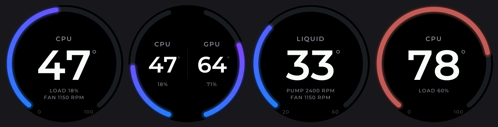

# Cooler Screen

An NZXT Kraken-style LCD for a Waveshare ESP32-S3-LCD-2.8C (480x480 round, no-touch variant), driven by CPU/GPU stats from a Windows tray app.



Modes: **CPU**, **GPU**, **CPU + GPU**, **Liquid** (coolant temp, pump and fan RPM) gauges, or a looping **GIF**. Ring colors (gradient or color that follows temperature), brightness and mode are set from the tray app and remembered by the device.

## Firmware (`esp32_app`)

Requires [PlatformIO](https://platformio.org/). The project uses the [pioarduino](https://github.com/pioarduino/platform-espressif32) platform (Arduino core 3.x).

```
cd esp32_app
pio run -t upload
```

The board connects over its native USB port (USB CDC). Board pins and timing live in `include/esp_panel_board_custom_conf.h` (touch disabled, pixel clock raised to 26 MHz to remove flicker on dim colors). If upload fails, hold **BOOT**, tap **RESET**, release **BOOT** and retry.

To preview the dashboard on a desktop: `g++ -O2 -std=c++17 -Isrc tools/preview.cpp src/gfx.cpp src/dashboard.cpp -o preview && ./preview .`
Fonts are generated from Montserrat (SIL OFL) with `python tools/gen_fonts.py` (needs Pillow).

## PC app (`host_app`, Windows)

```
cd host_app
py -3.13 -m venv venv
venv\Scripts\pip install -r requirements.txt
venv\Scripts\pythonw tray_app.py
```

To build a standalone app instead, run `build_exe.bat`; it produces `dist\CoolerScreen\CoolerScreen.exe` (no Python needed on the target PC, copy the whole `CoolerScreen` folder). Tick **Start with Windows** in Settings to launch it at logon via Task Scheduler with admin rights, without a UAC prompt.

The app asks for administrator rights (needed by LibreHardwareMonitor for CPU temperatures); pass `--no-elevate` to skip. Settings are stored in `%APPDATA%\CoolerScreen\config.json`; set `"port"` there to pin a COM port instead of auto-detecting.

GIFs are cropped to 480x480 and capped at 300 frames before upload; if that doesn't fit on the device it is re-encoded at 240x240 and scaled 2x on the screen.

Liquid temperature, pump and fan RPM are detected automatically by sensor name. If the wrong sensor is picked (or none), run `venv\Scripts\python monitor.py --list` as administrator and put part of the right sensor's name into `liquid_sensor`, `pump_sensor` or `fan_sensor` in the config file.

## Serial protocol

Newline-terminated commands:

| Command | Description |
| --- | --- |
| `PING` | Replies `PONG COOLERSCREEN 3` |
| `STAT:<cpuT>,<cpuLoad>,<gpuT>,<gpuLoad>,<liquidT>,<pumpRpm>,<fanRpm>` | Empty field = unavailable |
| `MODE:CPU\|GPU\|DUAL\|LIQUID\|GIF` | |
| `COLORMODE:GRADIENT\|TEMP` | Gradient along the ring, or one color picked by temperature |
| `THEME:<RRGGBB>,<RRGGBB>` | Ring gradient |
| `BRIGHT:<5-100>` | |
| `TRACK:<RRGGBB>` | Gauge track color |
| `UPLOAD:<size>,<crc32 hex>` | Device replies `READY`, then `ACK <n>` after each 4096-byte chunk, then `OK` or `ERR <reason>` |
